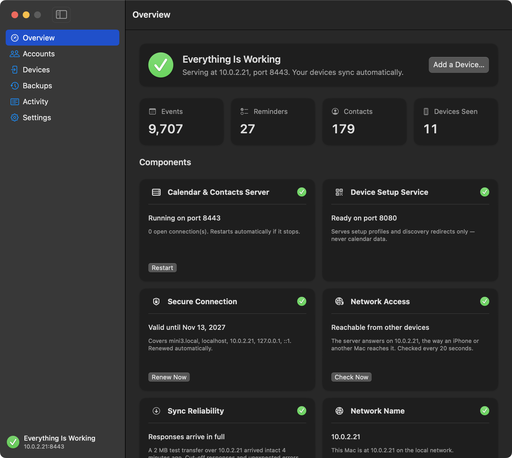

# CalShare

A macOS 15 application for locally syncing calendars, contacts, and reminders with other devices.

- Create a local CalDAV and CardDAV (RFC 4791, 6352) server with sync-collection, extended MKCOL, well-known discovery, and Bonjour advertisement.
- Simple setup (within the confines of Apple's clunky UX flows). Setup assistant walks you through creating an account, adding the server to your Mac (one configuration profile), and adding an iPhone or iPad (scan a QR code).
- All calendars, events, reminders, address books, and contacts are still created and managed in Apple's first-party applications.
- Server self-heals where possible. Listeners restart with backoff, a self-probe restarts a stuck server, and a damaged database is set aside and restored from the newest verified backup automatically.
- Encrypted connections from a private certificate authority generated on your Mac; certificates are reissued automatically.
- Optionally create multiple accounts, each with their own siloed content. Keep your data on your own devices and network.
- Optionally show CalShare in the MenuBar. Since the application must be running for devices to sync, you can also optionally close the application to the MenuBar (removing it from the Dock), and have it launch directly to the MenuBar as well.
- Automatic, verified backups every hour when anything has changed, with one-click restore. Export every calendar and address book to .ics and .vcf files.
- Invitations/scheduling between accounts, shared calendars, and attachments are not supported at this time.



## Installation and Usage

CalShare is not signed with an Apple Developer ID and is not notarized. To launch it, you can either disable Gatekeeper, remove the quarantine flag manually with the command below (using the appropriate path for your installation, of course), navigate to System Settings > Privacy & Security and click "Open Anyway" after first attempting a launch, or build it yourself with Xcode (open `CalShare.xcodeproj` in Xcode and choose Product > Build).

```sh
xattr -dr com.apple.quarantine "/Applications/CalShare.app"
```

On first launch, you must grant CalShare "Local Network" permission either from Apple's TCC popup alert or in System Settings > Privacy & Security > Local Network in order for the server to be discoverable and reachable.

Because CalShare can only serve content to clients while it's running, it is highly recommended that you enable the settings to launch the application at login and keep the server awake at all times (attached displays can still sleep, even if the Mac itself does not).

## System Requirements and Security

- macOS 15.6.0 or later, Apple Silicon only.
- "Local Network" permission via Apple's TCC system.
- Sandboxed, uses Apple's Hardened Runtime, and is compliant with Swift 6 (Strict Concurrency and Strict Memory Safety); built against Xcode 26.3.
- Clients must support TLS 1.3 to be able to authenticate with CalShare.
- Clients sync while this Mac is awake and reachable on the local network (using the Mac's `.local` name); to sync away from home, add a remote hostname that reaches the Mac (for example a Tailscale name) in Settings.
- Accepts incoming connections on two ports (by default, 8443 for calendars and contacts over TLS and 8080 for setup links and discovery redirects only).

## Support

If you find a bug, please report it here on GitHub and I will try to fix it. If it affects macOS 15, I will try harder. Please be as thorough in your reporting as you can.

You're welcome to request features or changes if you're so-inclined, and I will give such requests due consideration, but just know that this application was built first and foremost for an audience of one and I consider it largely feature-complete at this time.

CalShare is available in English only, by design.

## Note

I am not a software engineer; all of the code for this project was written by Anthropic's Claude models. That said, I use all of the applications under this account regularly in my daily life, so while they're not perfect, I'm confident in their efficacy and general reliability.

## License

CalShare is free software, licensed under the GNU General Public License, version 3 only (GPL-3.0-only). Copyright © 2026 avenged110. The full license text is in `COPYING`.
